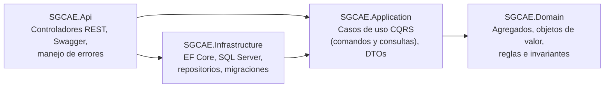
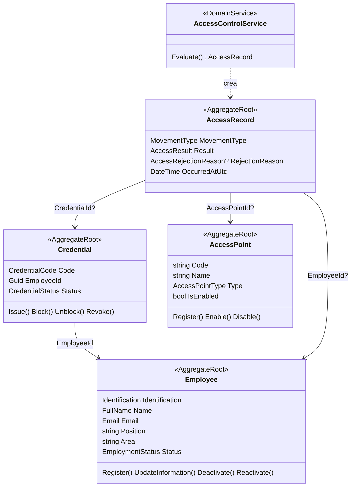

# SGCAE · Sistema de Gestión y Control de Acceso de Empleados

Backend empresarial para una empresa de servicios logísticos y de almacenamiento que hoy registra
los ingresos y salidas de sus empleados en planillas físicas y hojas de cálculo. El SGCAE centraliza
la información de los empleados, controla sus credenciales, registra cada movimiento de entrada y
salida (autorizado o rechazado) y permite consultar el historial de accesos.

| Tecnología | Uso |
|---|---|
| .NET 10 · ASP.NET Core Web API | Exposición de servicios REST |
| Entity Framework Core 10 | Persistencia y migraciones |
| SQL Server | Base de datos |
| Swagger / OpenAPI | Documentación y prueba de los endpoints |
| xUnit | Pruebas unitarias y de casos de uso |
| GitHub Actions | Compilación y pruebas automáticas en cada *push* |

## Problemas que resuelve

| Problema actual | Solución en el SGCAE |
|---|---|
| Registros duplicados | Identificación, correo y código de credencial únicos (reglas + índices únicos). Validación de secuencia: no se aceptan dos entradas seguidas ni salidas sin entrada en un mismo punto. |
| Dificultad para verificar la identidad | Cada movimiento se valida contra una credencial registrada y vinculada a un empleado. |
| Falta de trazabilidad | Se guarda **todo** intento de acceso, incluidos los rechazados, con su motivo, fecha UTC, credencial y punto solicitados. |
| Demora en los informes | Historial consultable por empleado, rango de fechas, punto de acceso y resultado, con paginación. |
| Ingreso de empleados inactivos | Un empleado inactivo es rechazado; además, al desactivarlo se revocan sus credenciales. |

## Arquitectura

La solución sigue **Clean Architecture**: las dependencias apuntan siempre hacia el dominio.



```
SGCAE/
├── src/
│   ├── SGCAE.Domain/           # Núcleo del negocio, sin dependencias externas
│   │   ├── Common/             # Entity, AggregateRoot, ValueObject, DomainException
│   │   ├── Employees/          # Agregado Empleado + Identification, FullName, Email
│   │   ├── Credentials/        # Agregado Credencial + CredentialCode
│   │   ├── AccessPoints/       # Agregado Punto de acceso
│   │   ├── AccessRecords/      # Agregado Registro de acceso
│   │   └── Services/           # AccessControlService (servicio de dominio)
│   ├── SGCAE.Application/      # Casos de uso (CQRS) y contratos
│   ├── SGCAE.Infrastructure/   # DbContext, configuraciones, repositorios, migraciones
│   └── SGCAE.Api/              # Controladores y configuración de la API
├── tests/
│   ├── SGCAE.Domain.Tests/     # Reglas e invariantes del dominio
│   └── SGCAE.Application.Tests/# Casos de uso de punta a punta (BD en memoria)
├── scripts/generar_evidencias.py
└── docs/                       # Evidencias y especificación OpenAPI
```

| Capa | Responsabilidad | Depende de |
|---|---|---|
| **Domain** | Entidades, objetos de valor, reglas de negocio, interfaces de repositorio | — |
| **Application** | Orquesta los casos de uso; define comandos, consultas, DTOs y el despachador | Domain |
| **Infrastructure** | Implementa la persistencia con EF Core sobre SQL Server | Application, Domain |
| **Api** | Expone los casos de uso como endpoints HTTP y traduce resultados a códigos HTTP | Application, Infrastructure (solo para registrar dependencias) |

## Modelo de dominio (DDD)



Los agregados se referencian entre sí **solo por identificador**, nunca por navegación, y cada uno
protege sus propias invariantes; las propiedades tienen *setters* privados y los cambios ocurren
únicamente a través de métodos con significado de negocio.

**Objetos de valor** (inmutables, comparados por valor, se validan al crearse):

| Objeto de valor | Regla |
|---|---|
| `Identification` | 5–20 letras o números, normalizada a mayúsculas |
| `FullName` | Nombres y apellidos obligatorios (máx. 100 c/u) |
| `Email` | Formato válido, normalizado a minúsculas |
| `CredentialCode` | 4–30 letras, números o guiones; se genera `CRED-XXXXXXXX` si no se envía |

**Reglas e invariantes principales**

- Identificación y correo del empleado son únicos; la identificación no se modifica.
- Un empleado inactivo no puede actualizarse ni recibir credenciales.
- Al desactivar un empleado se revocan sus credenciales vigentes o bloqueadas (misma transacción).
- Un empleado tiene como máximo una credencial no revocada; para emitir otra debe revocarse la actual.
- Ciclo de vida de la credencial: `Active ⇄ Blocked`, y `Active | Blocked → Revoked` (estado final).
  Bloquear y revocar exigen un motivo.
- Los puntos de acceso tienen código único y pueden habilitarse o deshabilitarse.
- **Validación de acceso** (`AccessControlService`), en este orden:
  1. La credencial existe → si no, `CredentialNotFound`
  2. La credencial no está bloqueada ni revocada → `CredentialBlocked` / `CredentialRevoked`
  3. El empleado está activo → `EmployeeInactive`
  4. El punto existe y está habilitado → `AccessPointNotFound` / `AccessPointDisabled`
  5. La secuencia en el punto es coherente → `AlreadyInside` (dos entradas) / `NotInside` (salida sin entrada)

  La secuencia se controla **por punto de acceso**: un empleado puede estar dentro de la recepción
  y entrar a la bodega; lo que no puede es registrar dos entradas seguidas en el mismo punto.

## CQRS

Los casos de uso se dividen en **comandos** (modifican estado) y **consultas** (solo leen):

- Los comandos (`ICommand<T>` → `ICommandHandler`) cargan agregados a través de repositorios,
  ejecutan los métodos del dominio y confirman con `IUnitOfWork`.
- Las consultas (`IQuery<T>` → `IQueryHandler`) usan `IReadDbContext`, que expone conjuntos
  **sin seguimiento de cambios** (`AsNoTracking`) y proyectan directamente a DTOs en SQL.
- Un despachador propio (`IDispatcher`) resuelve el manejador correspondiente y convierte las
  excepciones de dominio en resultados tipados (`Result<T>`), que la API traduce a HTTP:
  `Validation → 400`, `NotFound → 404`, `Conflict → 409`, con cuerpo `ProblemDetails`.

| Comandos | Consultas |
|---|---|
| `RegisterEmployee`, `UpdateEmployee`, `DeactivateEmployee`, `ReactivateEmployee` | `GetEmployeeById`, `ListEmployees` |
| `IssueCredential`, `BlockCredential`, `UnblockCredential`, `RevokeCredential` | `GetCredentialById`, `GetCredentialByCode`, `ListCredentials` |
| `RegisterAccessPoint`, `EnableAccessPoint`, `DisableAccessPoint` | `GetAccessPointById`, `ListAccessPoints` |
| `RegisterAccess` | `GetAccessRecordById`, `ListAccessRecords` |

## Endpoints

Documentación interactiva en **`/swagger`** (la raíz `/` redirige allí). Especificación exportada en
[`docs/openapi.json`](docs/openapi.json). Los enumerados viajan como texto (`"Entry"`, `"Rejected"`, …).

| Requisito | Método y ruta | Descripción |
|---|---|---|
| RF-01 | `POST /api/employees` | Registrar empleado |
| RF-01 | `GET /api/employees?search=&area=&status=&page=&pageSize=` | Listar/buscar (paginado) |
| RF-01 | `GET /api/employees/{id}` | Consultar empleado |
| RF-01 | `PUT /api/employees/{id}` | Actualizar datos |
| RF-01 | `POST /api/employees/{id}/deactivate` | Desactivar (revoca credenciales) |
| RF-01 | `POST /api/employees/{id}/reactivate` | Reactivar |
| RF-02 | `POST /api/credentials` | Asignar credencial (`code` opcional) |
| RF-02 | `GET /api/credentials?employeeId=&status=&page=&pageSize=` | Listar credenciales |
| RF-02 | `GET /api/credentials/{id}` · `GET /api/credentials/by-code/{code}` | Consultar estado |
| RF-02 | `GET /api/employees/{id}/credentials` | Credenciales de un empleado |
| RF-02 | `POST /api/credentials/{id}/block` · `/unblock` · `/revoke` | Cambiar estado (`{ "reason": "..." }`) |
| RF-03 | `POST /api/access-records` | Registrar entrada o salida |
| RF-04 | `GET /api/access-records?employeeId=&fromUtc=&toUtc=&accessPointId=&result=&movementType=&page=&pageSize=` | Historial (paginado, máx. 100 por página) |
| RF-04 | `GET /api/access-records/{id}` | Consultar un registro |
| RF-06 | `POST /api/access-points` | Registrar punto de acceso |
| RF-06 | `GET /api/access-points?isEnabled=&type=&page=&pageSize=` | Listar puntos (filtrar habilitados) |
| RF-06 | `GET /api/access-points/{id}` | Consultar punto |
| RF-06 | `POST /api/access-points/{id}/enable` · `/disable` | Habilitar / deshabilitar |

Ejemplo de solicitud de acceso (RF-03):

```http
POST /api/access-records
Content-Type: application/json

{ "credentialCode": "CRED-0001", "accessPointCode": "RECEPCION", "movementType": "Entry" }
```

La respuesta es siempre `201 Created` con el registro generado; el campo `result` indica
`Authorized` o `Rejected`, y en este último caso `rejectionReason` y `rejectionMessage` explican el motivo.

## Ejecución local

**Requisitos:** .NET SDK 10 y SQL Server (Express, Developer o LocalDB).

1. Clonar el repositorio:
   ```bash
   git clone https://github.com/JuanaOsp28/SGCAE.git
   ```
2. Ajustar la cadena de conexión `DefaultConnection` en
   `src/SGCAE.Api/appsettings.Development.json` (por defecto usa la instancia
   `localhost\MSSQLSERVER01` con autenticación de Windows). Para LocalDB, por ejemplo:
   `Server=(localdb)\\MSSQLLocalDB;Database=SGCAE;Trusted_Connection=True;TrustServerCertificate=True`
3. Ejecutar la API:
   ```bash
   dotnet run --project src/SGCAE.Api --launch-profile http
   ```
   En el entorno `Development` la API aplica automáticamente las migraciones y crea cuatro puntos de
   acceso iniciales (`RECEPCION`, `PARQUEADERO`, `BODEGA-01`, `CUARTO-SERV`).
4. Abrir <http://localhost:5009/swagger>.

Para aplicar las migraciones manualmente:

```bash
dotnet tool restore
```
```bash
dotnet ef database update -p src/SGCAE.Infrastructure -s src/SGCAE.Api
```

### Tablas generadas

`Employees`, `Credentials`, `AccessPoints` y `AccessRecords`, con índices únicos sobre
identificación, correo, código de credencial y código de punto de acceso, e índices de apoyo para
las consultas del historial (fecha, empleado + punto + resultado, punto + fecha).

## Pruebas y evidencias

```bash
dotnet test
```

- **62 pruebas automatizadas**: 40 de dominio (objetos de valor, ciclo de vida de credenciales,
  todas las reglas de validación de acceso) y 22 de casos de uso que ejecutan comandos y consultas
  a través del despachador con los repositorios reales sobre una base de datos en memoria.
- **[docs/EVIDENCIAS.md](docs/EVIDENCIAS.md)**: 38 peticiones reales contra la API en ejecución sobre
  SQL Server, con su cuerpo y la respuesta obtenida, que cubren todos los requisitos funcionales,
  incluidos los casos de error. Se regenera con:
  ```bash
  python scripts/generar_evidencias.py
  ```
- **GitHub Actions** compila y ejecuta las pruebas en cada *push* (`.github/workflows/ci.yml`).
